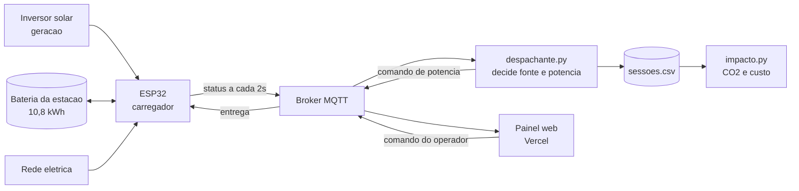

# GoodWe Charge

Sistema de gestão de recarga de veículos elétricos que decide de onde tirar a energia:
do sol, da bateria da estação ou da rede.

Sprint 4 — Solução Final Integrada. Turma 1CCPI, FIAP.

Vídeo da demonstração: (link)
Site publicado: https://goodwe23.vercel.app/
Projeto no Wokwi: (link)

## Equipe

| Nome | RM |
|---|---|
| Gustavo Kunitaki | 571400 |
| Kauanne Oliveira | 574191 |
| Nayhely Estela | 571416 |
| Pedro Ferreras | 568713 |
| Pedro Santos | 571017 |
| Victor Binot | 571499 |

## O que mudou nesta sprint

A Sprint 3 entregou a integração: o carregador publica seu estado e o painel manda parar
à distância. Faltava a parte que o desafio da GoodWe pede de verdade, que é a energia
renovável completa, com armazenamento, e uma decisão inteligente sobre quando usar cada
fonte.

Agora a estação tem bateria própria e um despachante que escolhe a origem da energia a
cada leitura. Quando o sol cobre a demanda, a recarga sai do inversor e o excedente
enche a bateria. Quando o sol cai, a bateria assume. Só quando acaba a reserva é que o
sistema puxa da rede, e se for horário de ponta ele segura a potência em vez de pagar
caro.

## Arquitetura final



O ESP32 faz o papel do equipamento: lê o nível de bateria do carro, a geração do
inversor, mantém o estado de carga do banco e aplica a potência que recebe. Ele também
decide a origem física da energia em três níveis, porque essa escolha precisa acontecer
no equipamento mesmo se a rede cair.

O despachante é o cérebro e roda em Python. Ele recebe cada leitura, decide qual
potência faz sentido naquele momento e publica o comando de volta. A decisão vem com o
motivo escrito, e é o motivo que aparece no painel: "acompanhando a geração solar de
4,2 kW" diz muito mais ao operador do que só um número caindo.

O painel web mostra tudo em tempo real e continua podendo cortar a recarga à distância.

### O algoritmo de despacho

A função `decidir()` pesa quatro variáveis:

| Variável | De onde vem | Por que entra na conta |
|---|---|---|
| Geração solar | potenciômetro que simula o inversor | define se a recarga sai de graça |
| Carga do banco | estado simulado no firmware | define se há reserva para cobrir o sol fraco |
| Horário | relógio do sistema | das 18h às 21h a energia da rede custa mais |
| Urgência | quanto falta para o limite do carro | carro quase cheio não precisa de potência máxima |

As cinco decisões possíveis, em ordem de prioridade:

1. Sol cobrindo a demanda cheia, carrega nos 7,4 kW com energia solar
2. Sol parcial, a potência acompanha a geração em vez de completar com a rede
3. Sol fraco e banco com carga, descarrega a bateria da estação
4. Sem sol, sem banco e horário de ponta, potência reduzida para 3 kW
5. Carro no limite de 80%, a recarga para sozinha

A exceção que corta todas: sessão a menos de 15 pontos do limite recebe potência
máxima, porque segurar um carro que está quase pronto só ocupa a vaga.

### Circuito

O mesmo da Sprint 3. O estado de carga da bateria da estação é calculado por software,
sem componente novo.

| Componente | Pino | Função |
|---|---|---|
| Potenciômetro 1 | GPIO 34 | Nível de bateria do carro |
| Potenciômetro 2 | GPIO 35 | Geração solar do inversor |
| LED verde | GPIO 2 | Carregamento liberado |
| LED vermelho | GPIO 4 | Carregamento interrompido |
| Botão | GPIO 15 | Plugue conectado |

## Onde isso encaixa no equipamento GoodWe

Cada peça do protótipo corresponde a um produto que a GoodWe já vende.

O carregador simula a linha **HCA**, cuja versão monofásica entrega 7 kW, que é a
potência usada no firmware. É compatível com qualquer marca de carro e se integra aos
inversores da marca.

O banco de 10,8 kWh são dois módulos da **Lynx Home U**, bateria LFP de 5,4 kWh que pode
ser ligada em paralelo e é monitorada pelo SEMS.

A geração vem do **inversor híbrido**, que é quem sabe quanto há de excedente em cada
momento. No protótipo esse número vem do potenciômetro.

A leitura real sairia do **SEMS Portal**. Ele expõe uma API não documentada, usada hoje
por bibliotecas em Python como a pygoodwe e por integrações de automação residencial.
Isso importa para o projeto: o caminho para ler o inversor de verdade já existe, é em
Python, e trocaria uma função do despachante sem mexer em mais nada.

A ideia que a GoodWe vende para uma casa, que é carregar o carro com o excedente do
próprio telhado, é a mesma aqui. A diferença é a escala: em vez de um cliente, um
operador com vários pontos, precisando decidir onde gastar a energia que tem.

## Resultados

O `impacto.py` lê o histórico de sessões e gera o `docs/impacto.md` com três blocos.

**Energia por fonte.** Quanto da recarga saiu do sol, da bateria e da rede, em kWh e em
participação.

**Pegada de carbono.** Dois números, e a diferença entre eles é o ponto mais
interessante do projeto. O CO₂ que deixou de sair da rede é pequeno, porque a matriz
elétrica brasileira já é limpa: o MCTI publicou fatores entre 21,5 e 28,9 kg de CO₂ por
MWh ao longo de 2025. O número grande vem de outro lugar, que é trocar gasolina por
eletricidade. Cada kWh entregue roda cerca de 5,5 km, e os mesmos quilômetros num carro
a gasolina custariam meio litro de combustível e 1,3 kg de CO₂.

**Custo.** A energia que veio do sol e da bateria é energia que não foi comprada da
concessionária, separando tarifa de ponta e fora de ponta.

A demonstração dura poucos minutos, então os valores medidos são pequenos por natureza.
Por isso o relatório também projeta a operação anual de uma estação de seis vagas,
mantendo a participação renovável que foi medida.

## Avaliação crítica

O ganho ambiental do nosso sistema no Brasil não vem de onde parece. Com o SIN emitindo
menos de 30 kg de CO₂ por MWh, cada kWh que deslocamos da rede para o sol evita cerca de
28 gramas. É pouco. O ganho real está em viabilizar a recarga: um ponto que carrega com
energia própria custa menos para operar e torna o carro elétrico competitivo contra a
gasolina, e aí sim a economia de carbono aparece em quilos por sessão.

O gerenciamento de demanda tem um efeito parecido. Ele não economiza energia, economiza
potência contratada, que é o que impede um condomínio de instalar seis vagas sem obra na
entrada. O benefício é de viabilidade, não de eficiência.

Também vale dizer o que não funciona ainda. O despachante não conhece previsão do tempo,
então ele reage à geração em vez de antecipar. Se soubesse que o sol volta em meia hora,
poderia segurar a recarga não urgente em vez de gastar o banco. O broker é público e sem
autenticação, o que serve para demonstração e não para operação. E o nível de bateria do
carro vem de um potenciômetro: num sistema real viria do veículo pela norma ISO 15118, e
o OCPP levaria esse dado à plataforma de gestão.

## Estrutura

```
.
├── README.md
├── entrega_sprint4.txt
├── firmware/
│   ├── sketch.ino           ESP32: tres fontes e bateria da estacao
│   ├── diagram.json         circuito do Wokwi
│   └── libraries.txt        dependencia (PubSubClient)
├── scripts/
│   ├── despachante.py       decide fonte e potencia, grava o historico
│   └── impacto.py           CO2, custo e projecao anual
├── dados/
│   └── sessoes.csv          gerado ao rodar o despachante
└── docs/
    └── impacto.md           gerado pelo impacto.py
```

O site fica em repositório separado: https://github.com/PHCDS/good_we_web

## Como rodar

Carregador: abrir o projeto no Wokwi, adicionar a biblioteca PubSubClient pelo Library
Manager e dar play.

Despachante:

```bash
pip install paho-mqtt
python scripts/despachante.py
```

Para ver a lógica de decisão sem precisar do hardware:

```bash
python scripts/despachante.py --teste
```

Relatório de impacto, depois de uma sessão gravada:

```bash
python scripts/impacto.py
```

Site: `npm install` e `npm run dev` no repositório do front.

## Conexão com a disciplina

**Pensamento Computacional em Python.** O despachante é o exercício da disciplina em
tamanho real. Decomposição ao separar leitura, decisão, registro e análise em funções e
arquivos distintos. Abstração ao representar o estado da estação em seis campos de um
JSON. Algoritmo na função `decidir()`, que é uma cadeia de condicionais com prioridade
definida, e no `impacto.py`, que percorre o CSV acumulando por categoria. O modo
`--teste` é o primeiro passo de teste automatizado do projeto: sete cenários fixos que
rodam sem rede e mostram a decisão de cada um.

**Redes e sistemas embarcados.** Publish/subscribe com tópicos hierárquicos, leitura
analógica por ADC de 12 bits, controle de saída digital e temporização por `millis()`
em vez de `delay()`, para o chip não perder comandos enquanto espera.

**Desenvolvimento web.** React com Vite e TypeScript, acesso separado por perfil, estado
atualizado por evento e deploy contínuo.

**Metodologia ágil.** Quatro sprints com entrega incremental. Nenhuma delas descartou a
anterior.

## Referências

- Fatores de emissão de CO₂ do SIN, publicados mensalmente pelo MCTI no SIRENE
- GoodWe: linha HCA de wallbox, bateria Lynx Home U (LFP, 5,4 kWh por módulo) e
  plataforma SEMS
- pygoodwe, biblioteca Python que consulta a API do SEMS Portal
- MQTT 3.1.1, biblioteca PubSubClient para ESP32 e paho-mqtt para Python
- ISO 15118 para comunicação entre veículo e carregador, OCPP entre carregador e
  central de gestão
